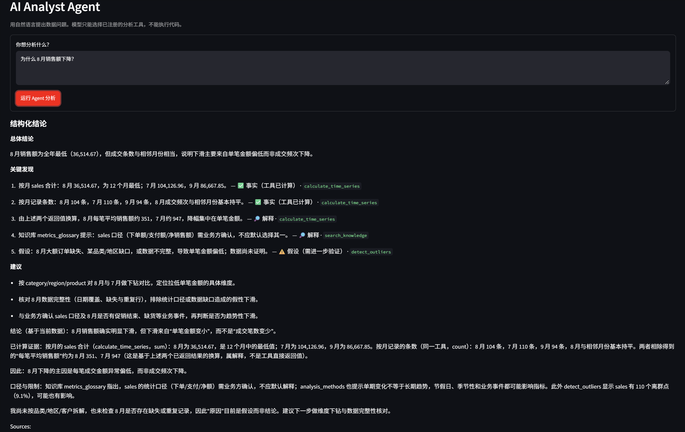
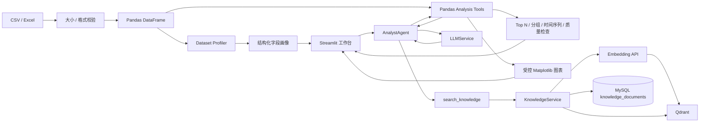
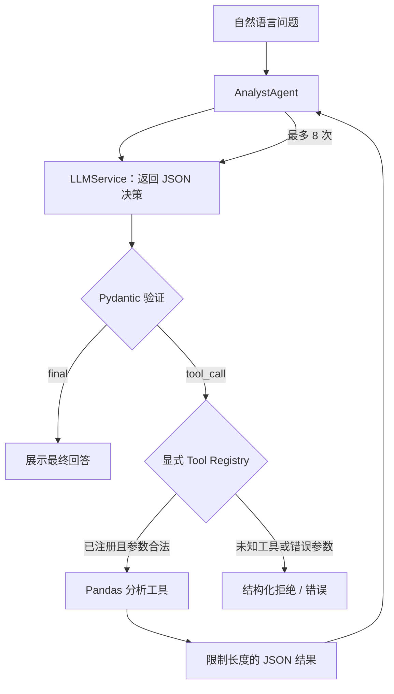
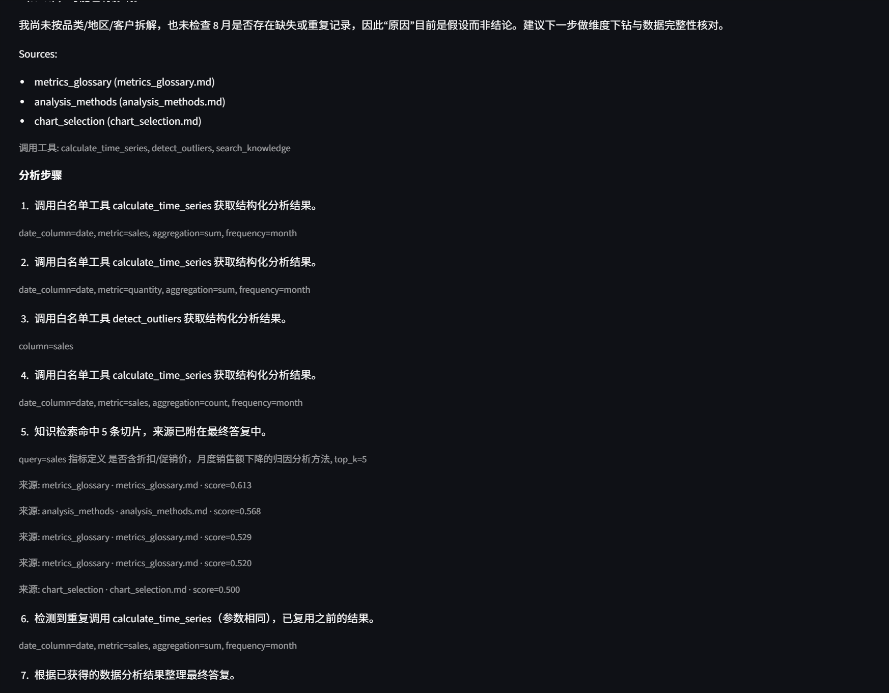
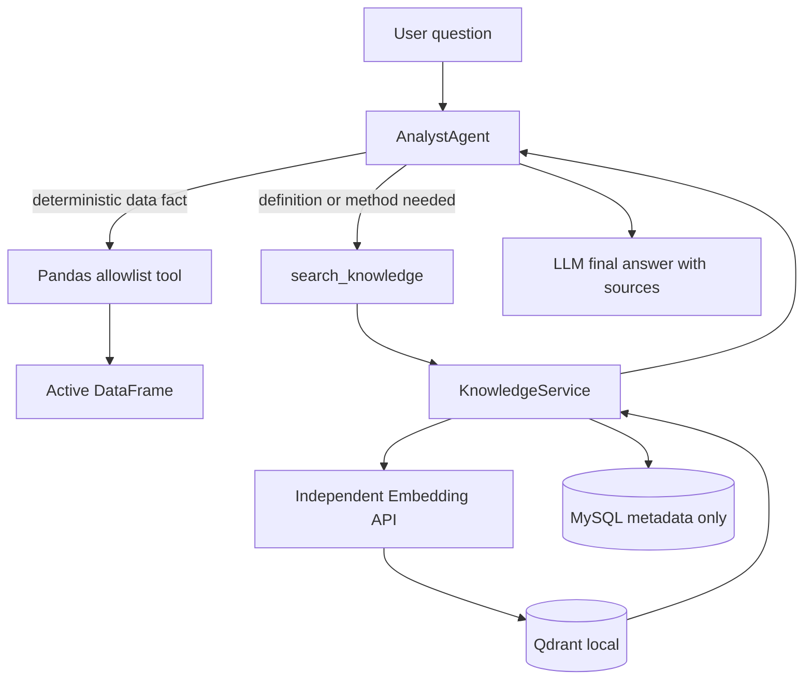
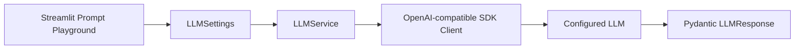

# DataPilot AI

## AI Data Analyst Agent — Phase 10 Evaluation MVP

**先理解数据，再用受控工具分析数据。** DataPilot AI 当前是一个可运行的 Pandas 数据分析工作台：上传 CSV/Excel 或载入合成销售数据，查看数据画像，并通过确定性工具完成分组统计、时间序列、质量检查与图表分析。

> 当前状态：Phase 1–10 已实现。**Phase 6 的 Agent Loop 与 Embedding → RAG 检索都已用真实服务端到端验证**（见下文"真实验证状态"）。CSV/Excel 仍由 Pandas 工具确定性分析；RAG 只检索数据分析方法和业务口径。MySQL 保存文档元数据，Qdrant 保存检索切片与向量。当前 UI 为 Streamlit，未实现 FastAPI。
>
> **尚未真实验证：**MySQL 连接与写入、LangSmith Trace。这两项目前只有离线 Mock 测试；未配置时代码不会伪造结果。



*演示：提问"为什么 8 月销售额下降？"后，Agent 只调用白名单工具，并把每条结论标注为 **✅ 事实（工具已计算）** / **🔎 解释** / **⚠️ 假设（需进一步验证）**，同时给出该结论的证据工具。标为"事实"的结论必须有真实运行过的工具作为证据，这是**代码强制**的，不是靠 Prompt 请求；"分析步骤"里还能看到每次调用实际用的参数（例如 `metric=sales, aggregation=sum`）。*

## 业务流程



## 已实现功能

- CSV、XLSX、XLS 上传；文件大小、行列数和格式校验；CSV UTF-8/GB18030 解码尝试。
- Dataset Profiler：字段语义推断、缺失/重复、数值/分类摘要、透明规则式质量评分。
- Analysis Playground：Top N、分组聚合、日/周/月/季度/年度序列、缺失分析、重复行、IQR 异常值、Pearson 相关系数。
- 折线、柱状、散点、直方图；服务端使用 Matplotlib Agg 后端，无 GUI 依赖。
- Pydantic 输入/输出模型；严格参数校验；分析工具注册表只允许调用明确登记的工具。
- Phase 4 UI：侧栏数据集状态、分区式字段画像、质量问题表格、双语结果展示；数据集变化时清理旧结果和列参数，语言切换保留当前数据。
- 简体中文/英文界面；使用合成数据，不含真实商业记录。
- Phase 5：统一配置、Pydantic 请求/响应模型、OpenAI-compatible 单次调用服务；超时、网络、API、空响应错误转为项目自有异常。
- 无 API Key 时进入明确标识的 Demo Mode：只显示固定说明，不发起模型调用，也不伪造 AI 结果。
- LLM Playground 可观察真实模式或 Demo 模式及 Token 使用量；页面只显示 Key 的配置状态，永不显示 Key 内容。
- Phase 6 AI Analyst：LLM 以严格 JSON/Pydantic 契约选择已有工具，Agent 最多执行 8 次决策；工具结果序列化并限制大小后才进入后续模型上下文。
- Agent 可靠性（Phase 6 加固，已真实运行验证）：容忍 Markdown 围栏的 JSON；解析失败时把校验错误回灌并重试；工具错误作为观察值反馈给模型自我纠正；参数完全相同的重复调用复用上次结果；最后一次决策强制收敛；SDK 传输重试（`LLM_MAX_RETRIES`）。**任何终止路径都会返回已经计算出的证据，而不是只返回一句错误。**
- 结构化结论：最终回答包含 Executive Summary / Key Findings / Recommendations，每条结论标注 `fact` / `interpretation` / `hypothesis`。**标为 fact 的结论必须有真实运行过的工具作为证据，否则自动降级为 hypothesis**，UI 用不同徽章区分。
- Agent 图表：模型只选择图表参数，Matplotlib 在服务端绘图，图表随 Agent 结果返回并在 UI 渲染（渲染后释放 figure）。
- Agent UI 仅在 LLM 配置完整时开放；无数据集可进行知识检索，有数据分析需求时 Pandas Tool 会要求先加载数据集；Demo Mode 不伪造工具调用。
- Phase 7 LangSmith：可选 Trace 覆盖 Agent、LLM 调用和工具调用，使用脱敏后的运行摘要；默认关闭。
- Phase 8 MySQL：SQLAlchemy 持久化数据集元数据、非原始字段画像和 Agent 运行摘要；数据库未配置/不可用不阻断分析。
- Phase 9 RAG MVP：Markdown/TXT Loader、标题/段落感知切块、独立 Embedding Service、本地 Qdrant、MySQL 知识文档元数据、Agent `search_knowledge` 白名单工具和检索 Trace。
- 知识检索不依赖 DatasetContext；Pandas 工具仍要求已加载数据集。Agent 每次运行最多检索两次，并拒绝相同查询重复调用。
- 内置分析方法、指标口径和图表选择知识；知识库 UI 支持索引内置文档与上传 Markdown/TXT。

## 安全边界和限制

数据分析只针对当前已加载的 DataFrame 与列名。Agent 只允许访问 `app/tools/registry.py` 中显式注册的函数，并通过 Pydantic Schema 校验参数；没有动态导入、`exec`/`eval`、任意 Python/SQL 或 Shell 工具。Agent 使用有限的工具结果记录，不存储 hidden chain-of-thought。质量分是规则估算；异常值是 IQR 筛查；相关性不代表因果。完整 CSV/XLSX 仅保留在当前 Streamlit 会话内存，不进入 MySQL 或 Qdrant。知识原文件保存在本地 `data/knowledge/uploads/`，目录被 Git 忽略；只上传获准用于 Embedding 和检索的 Markdown/TXT，不要上传密钥、个人信息或未授权资料。

## Phase 6：Agent Loop



工具只从静态注册表中精确查找，模型不能通过工具名动态导入 Python 模块。每次工具选择、结果或最终回答形成可展示步骤摘要；摘要由应用生成，不保存模型内部推理过程。单元测试 Mock `LLMService`，不需要 Key 或外网。

**执行过程是可审计的**——下面是一次真实运行的"分析步骤"：每一步显示调用了哪个白名单工具、**实际传入了什么参数**，以及知识检索命中了哪些来源和分数。第 6 步还能看到"参数相同的重复调用被识别并复用之前的结果"，而不是浪费一次决策。



## Phase 7：LangSmith Observability

LangSmith 是独立的可观测层，用来查看 Agent 决策步骤、模型调用耗时/Token 用量、工具名称、参数类型摘要、成功状态和结果行列数量。它不决定工具、不改变 Agent 结果，Trace 传输失败也不会中断分析。

在 `.env` 中填入可选配置：

```dotenv
LANGCHAIN_TRACING_V2=false
LANGCHAIN_API_KEY=
LANGCHAIN_PROJECT=datapilot-ai
LANGCHAIN_ENDPOINT=
```

默认 tracing 关闭；启用时将 `LANGCHAIN_TRACING_V2=true` 并填写 `LANGCHAIN_API_KEY`。官方 SDK 当前推荐 `LANGSMITH_TRACING`、`LANGSMITH_API_KEY`、`LANGSMITH_PROJECT` 和可选 `LANGSMITH_ENDPOINT`；本项目同时读取这组新名称和模板中的 `LANGCHAIN_*` 兼容名称，新名称优先。官方 endpoint 留空时由 SDK 使用默认地址。[LangSmith custom instrumentation 文档](https://docs.langchain.com/langsmith/annotate-code)

Trace 层级为 `DataPilot AnalystAgent` 根 run，下面包含每轮 `Agent Decision` 和 `Tool: <name>`；每个决策内部包含 `OpenAI-compatible LLM Call` 子 run。SDK 的 `trace` context manager 负责上下文传播和父子关系。

**隐私边界：**启用后，用户问题的 SHA-256 摘要和长度、数据行列计数、工具名称以及受限的执行摘要会发送到 LangSmith。模型 Prompt/Completion 正文、文件名、字段名、完整工具结果和 DataFrame/CSV/XLSX 内容不会写入 Trace；工具参数只记录结构类型和字符串长度。LangSmith UI 状态不会显示 API Key。

Demo Mode 下 Agent 直接返回不可用状态，不创建 Agent、LLM 或工具 Trace。Tracing 开启但 Key 缺失/endpoint 无效时，UI 显示配置不完整，业务仍可运行且不发送 Trace。Trace 验证测试使用本地 Mock，不连接 LangSmith；要验证真实 Trace，配置有效 Key 并通过一次真实 LLM 请求，然后在 LangSmith 项目 `datapilot-ai` 查看运行记录。当前开发环境没有有效 LangSmith Key，**未验证真实 Trace**。

## Phase 8：MySQL Persistence

MySQL 只负责元数据持久化，不替代 Pandas：

```text
Streamlit → DatasetContext → PersistenceService → Repository → SQLAlchemy → MySQL
                         └→ DataFrame → Pandas Tools / Agent
```

Schema 集中定义在 `app/database/models.py`：

- `datasets`：数据集 ID、文件名、来源、行列数、缺失/重复数量、质量评分和时间戳。
- `dataset_columns`：字段名、语义类型、Pandas 类型、缺失率和唯一值数量。
- `analysis_runs`：问题、数据集 ID、Agent 模式/状态、迭代数、工具列表、耗时和创建时间。

不存完整原始数据、Prompt、Completion、LangSmith Trace 或 hidden chain-of-thought。字段画像只存类型和计数等结构信息，不存 Top values 或原始单元格。Agent 的用户问题会保存到 MySQL，可能包含敏感信息；部署前应按组织数据策略决定是否开启持久化。数据库凭据只从环境变量读取，UI 不显示连接串或密码。

MySQL 是可选项。将 `.env.example` 中的 `MYSQL_USER` 和 `MYSQL_PASSWORD` 配置好后，应用会幂等创建缺失的表（只执行 `CREATE TABLE IF NOT EXISTS` 语义，不删除数据）。也可手动初始化：

```powershell
.\.venv\Scripts\python.exe -m app.database.init
```

```dotenv
MYSQL_HOST=localhost
MYSQL_PORT=3306
MYSQL_DATABASE=datapilot
MYSQL_USER=
MYSQL_PASSWORD=
```

留空 `MYSQL_USER` 会关闭持久化。数据库无法连接或写入失败时，页面显示状态警告；DataFrame、Pandas Tools、Agent 和 LLM 仍继续使用当前内存数据。单元与集成测试使用 SQLite `:memory:`，不要求本机 MySQL。

## Phase 9：RAG Knowledge Assistant

RAG 用于补充数据分析所需的**分析方法和业务口径**，不替代 Pandas 计算，也不把 CSV、DataFrame 或完整 Dataset Profile 自动向量化。



**知识文档来源：**内置的 `analysis_methods.md`、`metrics_glossary.md`、`chart_selection.md`，以及用户明确上传的 `.md`/`.txt`。Phase 9 不支持 PDF、DOCX、Excel、CSV 知识文档。

**Index 流程：**Loader 校验扩展名、UTF-8 和 1 MiB 大小上限 → 规范化文本和 SHA-256 → Markdown 标题 / TXT 段落感知 chunk → 独立 Embedding API → Qdrant upsert → MySQL 文档状态更新。若 Embedding 或 Qdrant 失败，文档状态不会变成 `indexed`。

初始切片参数约为 450 tokens，overlap 约 60 tokens，hard max 约 700 tokens；通过轻量中英文边界估算切块，不同模型的 Tokenizer 可能产生差异。它们是 MVP 初值，不代表已评估最优。

**检索流程：**Agent 按问题决定是否调用 `search_knowledge`；检索按可信的知识库 ID、当前数据集 ID 过滤，最多返回 5 个 chunk，每段不超过 1000 字符，总正文不超过 4000 字符。没有相关结果返回 `no_results`；不设置未经评估校准的相似度阈值；Phase 9 不包含 Reranker、BM25 或 Hybrid Search。Agent 最多进行两次知识检索，拒绝同一查询重复调用。

**MySQL 与 Qdrant：**MySQL `knowledge_documents` 是文档元数据和索引状态的来源；Qdrant `datapilot_knowledge` 保存 chunk、Embedding 和检索 metadata。MySQL 不保存完整文档正文、chunk 或向量。知识原文件保存在本地被忽略的 `data/knowledge/uploads/`，便于后续重建索引。

**Embedding 配置：**Chat LLM 与 Embedding Provider 完全独立。建议选择支持 `BAAI/bge-m3` 的 OpenAI-compatible Embedding endpoint；项目不会假设当前 Chat endpoint 支持 Embedding。`.env.example` 中默认 `EMBEDDING_PROVIDER=disabled`，未配置时 UI 明确显示 `Embedding unavailable`，不生成假向量。`EMBEDDING_DIMENSIONS` 必须与 Provider 实际返回相符。更换向量维度时，现有 collection 会拒绝使用；请先备份需要的数据，再配置新的 `QDRANT_COLLECTION` 或新的 `QDRANT_PATH` 后重建。

```dotenv
EMBEDDING_PROVIDER=disabled
EMBEDDING_MODEL=BAAI/bge-m3
EMBEDDING_API_KEY=
EMBEDDING_BASE_URL=
EMBEDDING_TIMEOUT=20
EMBEDDING_DIMENSIONS=1024
QDRANT_PATH=data/qdrant
QDRANT_COLLECTION=datapilot_knowledge
```

运行页面后在 **Knowledge Base / 知识库** 区域点击“索引内置分析知识”，或上传 Markdown/TXT 后点击“索引文档”。Embedding 未配置时，索引按钮不会启用。Agent 没有加载 Dataset 时仍可回答有文档依据的知识问题；Pandas 分析工具会以 `dataset_missing` 拒绝执行。使用 RAG 时，最终回答会附加实际检索结果中的来源标题，不从模型生成来源名。

**LangSmith Trace：**每次 RAG 调用增加 `Knowledge Retrieval` 子 span，记录 query SHA-256 摘要、长度、top-k、知识库/数据集 ID、耗时、结果数、文档/切片 ID 和 score；不记录查询全文、chunk 正文或向量。

**本地验证边界：**自动化测试使用真实 Qdrant 本地持久化客户端验证 collection、upsert、检索过滤和删除；Embedding API 使用 Mock 验证接口和失败处理。当前尚未验证真实 Embedding Provider、真实 MySQL 服务或远程 Qdrant 服务，也未验证真实 LangSmith Trace。Qdrant local 适合单机学习和 MVP；本地目录不应由多个进程同时打开。

## Phase 10：Evaluation

Evaluation 针对现有 `AnalystAgent.run(AgentRequest)` 执行，不复制 Agent Loop，也不修改 Tool Registry 或 RAG 检索策略。固定数据集 `data/evaluation/datapilot_mvp_v1.json` 包含 15 个小型 Case：6 个 Pandas 确定性分析、知识检索/引用/grounding、RAG + Pandas 联合任务、预期检索未命中、问候和缺少 Dataset 等执行场景。

```text
Evaluation Dataset (Pydantic validated)
       ↓
EvaluationRunner ── dependency gate: passed / failed / skipped / unavailable
       ↓ public AgentRequest / AnalystAgent.run
AgentResponse.steps ── tools / retrieval IDs / citations / iterations
       ↓
Deterministic Metrics + Pandas Ground Truth Comparator
       ↓
EvaluationReport → Streamlit table / JSON download / optional LangSmith trace
```

**指标：**Tool Selection 按 expected tool 集合判断，允许额外工具且不要求调用顺序；RAG 使用文档/切片 ID 计算 Hit@1/3/5，并单独计算预期 miss 是否返回空结果；引用根据精确的来源名、标题或 ID 与实际检索结果核验，并计算 Precision/Recall；Grounded Answer 是结构化证据代理指标，不是通用语义真值；Agent 指标包含成功率、超过 8 轮、未注册工具和重复工具调用率。所有指标均携带 numerator/denominator；没有可评估 Case 时显示 N/A。

**Ground Truth：**Pandas 期望结果来自 `data/sample_sales.csv` 和当前已注册 Pandas 工具的实测结构化输出。`exact_match` 比较类型和值，`numeric_tolerance` 用绝对/相对误差，`set_match` 忽略集合顺序。Evaluation runner 仅允许 `sample_sales` 固定别名，不读取数据集文件路径、不接收 Python/SQL 片段，也不执行 `eval`/`exec`。报告不保存完整 DataFrame、工具证据正文或模型答案。

**LLM Judge：**可在页面手动勾选；默认关闭且需要额外 LLM 调用。输出经过 Pydantic 校验，单独标识 `judge_status`，仅作为辅助观察，不影响 Case 通过状态或确定性 Ground Truth。`LLM Judge ≠ ground truth`。

**LangSmith Evaluation Trace：**配置 LangSmith 后，每个评估 Run/Case 记录 Case ID、类别、问题哈希与长度、执行状态、工具名、检索文档/切片 ID、轮数、脱敏指标和耗时。Agent/LLM/RAG 继续沿用 Phase 6/7/9 的安全摘要 Trace。Trace 不记录完整问题/答案、Prompt、Completion、DataFrame、Embedding、API Key 或 hidden CoT；本地 JSON 报告仅含固定 Evaluation Case 问题与结果元数据，不含运行时完整答案或数据集。LangSmith 未配置时使用 no-op trace，不影响评估。

**运行：**打开 Streamlit 的 `Evaluation / 评估` 区域，点击“运行 Evaluation”。此操作才会运行案例和调用已配置的 LLM；LLM Judge checkbox 默认关闭。结果区分 `passed`、`failed`、`skipped`（例如 Embedding/Qdrant 不可用）与 `unavailable`（例如 LLM 未配置），只对实际执行的 Case 计算 pass rate；可以下载脱敏结构化 JSON 报告。当前采用固定小数据集和离线 Mock 测试，不等价于真实 LLM/RAG 效果基准；真实效果需要配置服务后运行并检查每个 Case。

## Phase 5：LLM 配置

复制 `.env.example` 为 `.env`，仅在需要真实模型调用时填写：

```dotenv
LLM_API_KEY=
LLM_BASE_URL=
LLM_MODEL=
LLM_TIMEOUT=30
LLM_MAX_TOKENS=1024
# 传输层重试交给 OpenAI SDK（覆盖超时、429、5xx，带指数退避）。默认 2；设为 0 可关闭。
LLM_MAX_RETRIES=2
```

`LLM_BASE_URL` 使用提供商给出的 OpenAI-compatible API 根地址，例如以 `/v1` 结尾的地址。不要把 Key 提交到 GitHub。没有 Key 时应用仍可启动并显示 Demo Mode；配置 Key 后若 Base URL/Model 不完整，页面会提示修正配置，不会伪装为 Demo AI 答案。

调用边界：



`app/config/settings.py` 统一加载 `.env` 和环境变量；`app/services/llm_service.py` 创建客户端、请求模型并把 SDK 响应转为稳定的 Pydantic 契约。测试通过 Mock Client 执行，不需要 API Key 或网络。

## 运行（Windows PowerShell）

```powershell
cd "C:\Users\35002\Documents\Codex\2026-10-04\DataPilot-AI"
python -m venv .venv
.\.venv\Scripts\python.exe -m pip install -r requirements.txt
.\.venv\Scripts\python.exe -m streamlit run app/ui/streamlit_app.py
```

打开 Streamlit 输出的本地网址。左侧选择“使用 Demo 数据”，即可看到合成数据画像及分析标签页；也可切换“上传文件”导入自己的 CSV/Excel。

Linux/Ubuntu：创建虚拟环境后使用 `.venv/bin/python -m pip install -r requirements.txt`，再运行 `.venv/bin/python -m streamlit run app/ui/streamlit_app.py`。

## 测试和代码检查

```powershell
.\.venv\Scripts\python.exe -m pytest -q
.\.venv\Scripts\python.exe -m pip check
```

单元测试不调用网络、真实 LLM 或远程数据库；Qdrant 测试使用真实本地持久化客户端和临时目录。`tests/test_streamlit_ui.py` 使用 Streamlit AppTest 覆盖 Demo 分析、柱状/折线图、语言切换，以及 Demo → 两份上传 CSV → Demo 的会话状态切换。演示数据为 `data/sample_sales.csv`。

`tests/test_i18n.py` 额外做三项静态检查：中英两语言文件的键集合与顺序必须一致、UI 引用的每个 i18n 键必须在两种语言中都存在、**UI 源码里不允许出现硬编码中文**（语言选择器本身除外）。这样新增页面时不可能再漏做翻译。

## 配置验证工具

`scripts/check_embedding.py` 在把 Embedding 服务商写进 `.env` 之前先验证它，检查 5 项：端点可达与向量维度、维度与配置一致、批量请求与顺序稳定、同一文本结果确定、**语义有效性（近义句相似度必须高于无关句）**。最后一项用来防止把返回随机/占位向量的端点写进知识库——那种情况下前四项都会"通过"，但检索毫无意义。

```powershell
# 不联网自检脚本自身逻辑
.\.venv\Scripts\python.exe scripts\check_embedding.py --self-test

# 在写入 .env 之前试一个候选服务商
.\.venv\Scripts\python.exe scripts\check_embedding.py `
  --base-url https://api.siliconflow.cn/v1 --api-key sk-xxxx `
  --model BAAI/bge-m3 --dimensions 1024
```

全部通过时脚本会直接打印可粘贴进 `.env` 的配置块；脚本从不打印 API Key。

`scripts/check_rag.py` 在配置好 `.env` 之后验证检索本身真的可用：索引内置知识文档 → 用相关问题检查期望文档是否命中（并给出排名与分数）→ 用无关问题比较最高分。它**不把"无关问题必须返回 no_results"当通过条件**，因为项目刻意不设未经校准的相似度阈值；无关问题仍会返回低分切片，这一点在脚本输出里明确说明。

```powershell
.\.venv\Scripts\python.exe scripts\check_rag.py
```

## 真实验证状态

| 项目 | 状态 | 证据 |
|---|---|---|
| 离线测试 | 通过 | `pytest -q`，全部通过 |
| 真实 LLM 单次调用 | 通过 | 配置真实 Key 后由 `LLMService` 实际调用 |
| **真实 Agent 端到端** | **通过** | 6 个代表性中文提问（趋势、归因、Top N、异常、分组、图表）全部成功，均返回结构化结论；图表随结果返回 |
| **Embedding → RAG 端到端** | **通过** | `scripts/check_rag.py`：11 个切片；3 个相关问题全部**排名第 1** 命中；相关最高分 0.7728 vs 无关 0.3109。Agent 级：纯知识问答、知识+Pandas 组合、知识库无关问题三种场景 3/3 成功，**编造来源 0 条** |
| MySQL 读写 | **未验证** | `MYSQL_USER` 为空时持久化整体关闭 |
| LangSmith Trace | **未验证** | 默认关闭；未产生真实 Trace |

**检索不可用时的诚实行为（已验证）：**当知识库不可用或没有检索到内容时，`AgentResponse.retrieval_status` 为 `unavailable`/`no_results`，步骤摘要与 UI 都会明确说明"以下内容来自模型自身知识，不属于本项目知识库的证据"，模型也被要求主动声明。修复前的行为是：运行标记为成功、工具记为已调用、步骤说"获取结构化分析结果"，用户会把模型自己的知识当成知识库证据。

真实的验收记录与命令输出见 [docs/real_run_acceptance_v2.md](docs/real_run_acceptance_v2.md)（加固后的当前状态）与 [docs/real_run_acceptance.md](docs/real_run_acceptance.md)（加固前的历史快照）；审查与修复过程见 [docs/code-review-and-next-steps.md](docs/code-review-and-next-steps.md)。LLM endpoint 存在间歇性连接失败；失败时 Agent 返回已经计算出的证据并把未完成的部分标注出来，不会伪造结论。

## 技术栈（当前已使用）

- Python 3.11+
- Pandas、NumPy
- Pydantic
- Streamlit
- Matplotlib
- OpenAI Python SDK（OpenAI-compatible Chat Completions）
- Qdrant Python Client（local persistent vector store）
- OpenAI-compatible Embedding API（独立配置，可选）
- SQLAlchemy / PyMySQL（可选 MySQL metadata persistence）
- LangSmith Python SDK（可选 Observability）
- pytest

## 目录

```text
app/
├── models/       # Profiler、DatasetContext、分析请求与结果契约
├── services/     # 文件读取、画像、LLM、Embedding、Knowledge、Trace 和持久化
├── knowledge/    # Markdown/TXT Loader 与中文/英文切块
├── vectorstore/  # Qdrant adapter
├── database/     # SQLAlchemy schema、engine 和幂等初始化入口
├── repositories/ # 数据集、分析运行、知识文档元数据仓储
├── tools/        # Pandas、可视化、知识检索白名单工具
└── ui/           # Streamlit 应用
 data/            # 合成 Demo CSV、内置知识和本地忽略目录
 docs/            # 算法、数据画像、工具说明、审查报告、真实运行验收记录与面试演示稿
 docs/images/     # README 界面截图（拍摄与引用约定见该目录的 README）
 i18n/            # 中英文 UI 文案
 scripts/         # 配置自检工具（Embedding provider 与 RAG 检索自检）
 tests/           # 离线单元测试
```

## 分阶段路线

- **Phase 1**：项目骨架、数据加载、可复现合成数据。
- **Phase 2**：Dataset Profiler 和画像页面。
- **Phase 3**：受控 Pandas 分析工具与图表。
- **Phase 4**：完整双语 Streamlit 工作台、数据集状态和分析结果呈现。
- **Phase 5**：LLM 配置、模型契约、单次 Prompt Service、Demo Mode 和 Mock 测试。
- **Phase 6**：受控 Agent Loop、JSON Tool Selection、注册表白名单、Pydantic 参数校验、结果长度限制和 Demo Mode UI。
- **Phase 7**：可选 LangSmith Trace、自定义运行层级、敏感数据摘要、状态展示和离线 Mock 验证。
- **Phase 8**：可选 MySQL 元数据和 Agent 运行持久化；Pandas 内存分析保持独立。
- **Phase 9**：分析知识 RAG MVP、Qdrant、本地 Markdown/TXT、`search_knowledge` Agent Tool、MySQL 文档元数据与检索 Trace。
- **Phase 10（当前）**：固定 Dataset、可解释 RAG/Agent/Pandas Metrics、确定性 Ground Truth、可选 Judge 与 Streamlit Evaluation 页面。
- **Phase 10 后加固**：Agent 可靠性（JSON 修复重试、错误观察回灌、重复调用复用、强制收敛、传输重试、部分结果降级）、结构化结论与事实/推测强制分离、Agent 图表链路、数据入口正确性（分隔符嗅探、标识列文本化、数值日期列拒绝、前置行数限制）、知识库重索引一致性、评估指标完整性。详见 [docs/code-review-and-next-steps.md](docs/code-review-and-next-steps.md) 第八节。

详细算法、输入限制、边界条件见 [docs/analysis-tools.md](docs/analysis-tools.md) 和 [docs/dataset-profiler.md](docs/dataset-profiler.md)。
