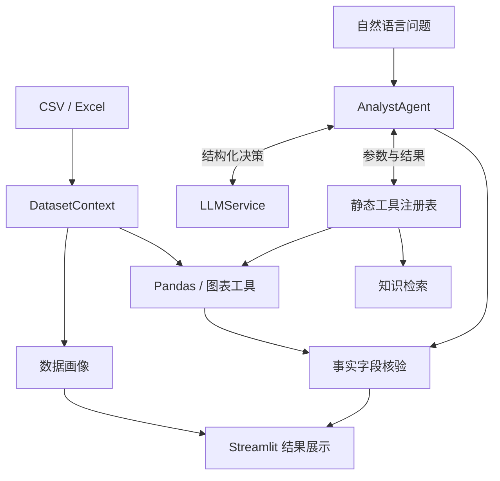

# 架构设计

[返回项目首页](../README.md) · [配置指南](configuration.md) · [评估说明](evaluation.md)

DataPilot AI 使用 Streamlit 提供交互，Pandas 负责确定性计算，LLM 根据问题选择已注册工具。知识检索、元数据持久化与 Trace 为可选集成。

## 数据与工具



- `DatasetContext` 持有当前 DataFrame 与结构化画像；切换数据集会清理旧分析结果。
- `app/tools/registry.py` 是唯一的工具名称到函数映射。模型参数先经过 Pydantic 校验，再调用已注册函数。
- 工具覆盖 Top N、分组聚合、时间序列、缺失与重复检查、IQR 异常值、Pearson 相关和四类图表。
- 模型不能动态导入模块，也不能执行任意 Python、SQL、Shell 或文件访问。

算法与输入限制见 [分析工具](analysis-tools.md) 和 [数据画像](dataset-profiler.md)。

## Agent 循环

每次决策必须返回 `tool_call` 或 `final` 的 JSON 对象。Agent 最多执行 **8 次决策**，其中知识检索最多 **2 次**。

1. 根据问题、数据集结构和受限的工具结果构建上下文。
2. 校验模型决策，再执行白名单工具。
3. 将结果或可恢复错误作为下一轮观察值。
4. 生成结构化结论，并核对事实引用。

实现包含 JSON 格式修复、可恢复工具错误回灌、重复调用复用、传输重试和最后一轮收敛。网络失败或达到上限时，会保留已经计算出的证据，并标明分析未完整结束。

## 事实与解释

事实引用必须指定本轮成功调用的 `call_id`、结果字段、值与单位。核对通过后，事实文本由程序生成；未通过就降级为假设。完整工具结果仅在本轮内存中用于核对，模型观察值仍受长度限制。

总结、解释、建议和原始叙述来自模型，未经程序校验；字段一致也不代表业务口径必然正确。详见 [事实证据校验](fact-evidence.md)。

## 知识检索

知识库用于补充分析方法、指标定义与业务口径，不替代数值计算，也不会自动向量化 CSV、DataFrame 或完整数据画像。

```text
Markdown / TXT → 标题与段落切块 → 独立 Embedding API → Qdrant
用户问题 → 按知识库与数据集过滤 → 最多 5 个候选切片 → Agent
```

- 文档来自内置分析知识，或用户明确上传的 Markdown / TXT。
- Loader 校验 UTF-8、文件类型和 1 MiB 上限。初始切块约 450 tokens，重叠约 60，硬上限约 700；Token 数为轻量估算。
- 检索单段正文最多 1000 字符，总正文最多 4000 字符。不包含 Reranker、BM25 或混合检索。
- 当前不设未经校准的相似度阈值，无关问题也可能返回低分候选。空索引或过滤后无候选时返回 `no_results`。
- 来源由真实检索结果生成。不可用、无结果和未检索的状态分别展示；不能把模型通用知识当成知识库证据。

## 存储与隐私

| 位置 | 保存或传输的内容 |
| --- | --- |
| Streamlit 会话 | 当前 DataFrame、工具结果、事实引用与图表 |
| LLM Provider | 问题、数据集结构与受限的工具观察值；属于真实外部调用 |
| 本地知识目录 | 用户明确上传的知识原文件，目录被 Git 忽略 |
| Embedding / Qdrant | 知识切片及其向量、来源和过滤信息 |
| MySQL（可选） | 数据集元数据、非原始字段画像、运行摘要、用户问题和知识文档状态 |
| LangSmith（可选） | 问题哈希与长度、工具名称、参数结构、计数和耗时等摘要 |

完整 CSV / DataFrame 不写入 MySQL、Qdrant 或 LangSmith。工具观察值和知识正文可能发送到已配置的模型或 Embedding 服务；启用持久化前也应考虑用户问题可能包含敏感信息。

MySQL 不保存原始单元格、完整知识正文、向量或模型 Prompt / Completion。LangSmith 不记录问题与答案正文、文件名、字段名、工具结果正文或隐藏推理。

MySQL 与 Trace 故障不阻断内存分析。Qdrant local 面向单进程使用，同一目录不能由多个进程同时打开。真实服务验证边界见 [首页验证状态](../README.md#验证状态)。
